# Chicken House — Visual overhaul / 2026-11-19

最新の実ゲーム画面です。最初のレビュー対象を武器にし、静止・チャージ・発砲・セル交換を比較できます。設計、変更ファイル、検証と制約は [改修レポート](FPS_ART_REPORT.md) を参照。

## ARC-RG7 — 静止 / 両手の構え / 発光グリフ

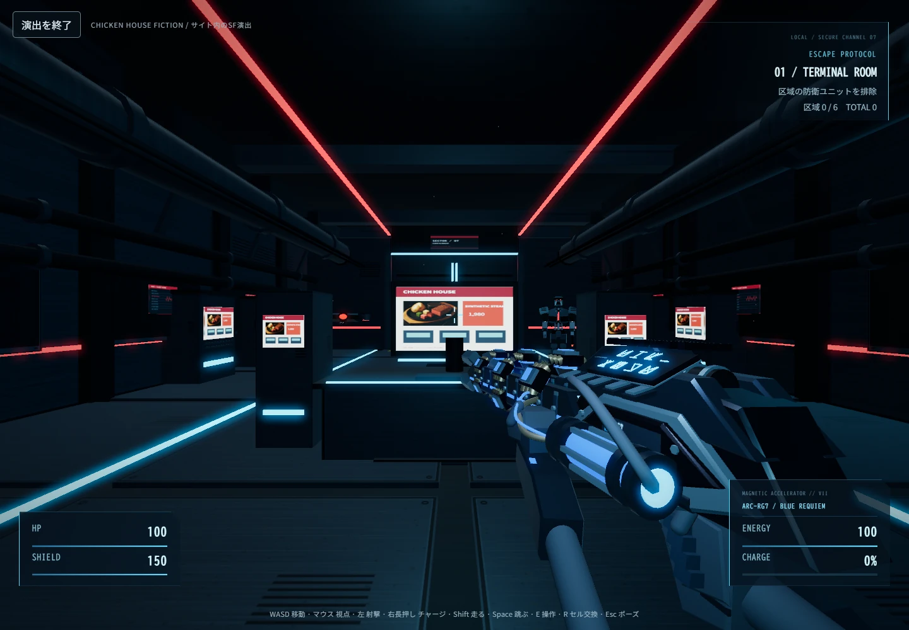

## チャージ

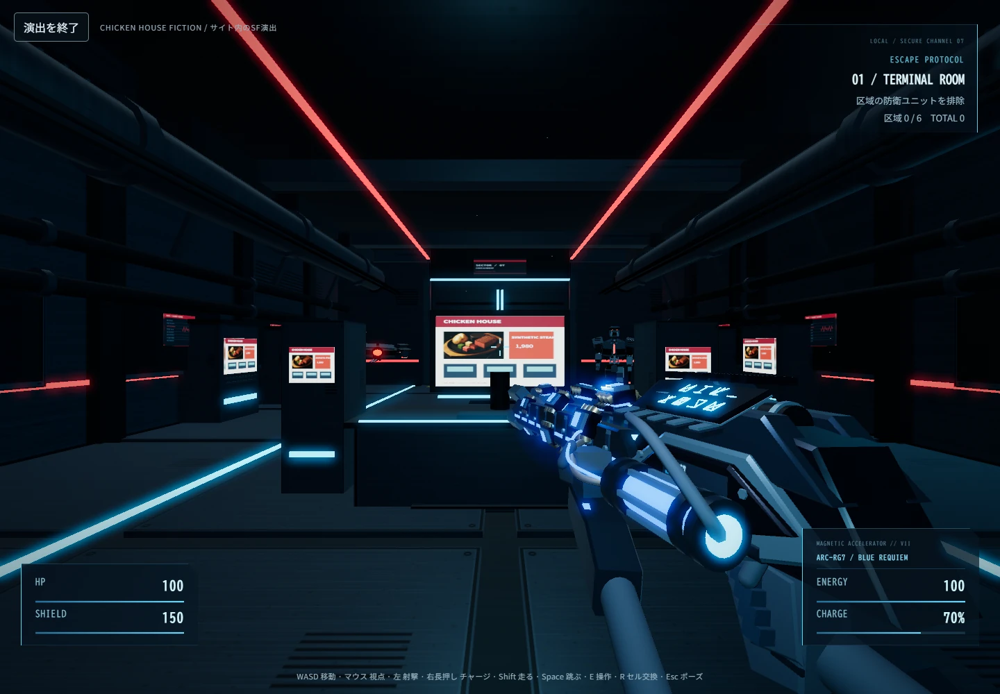

## 発砲

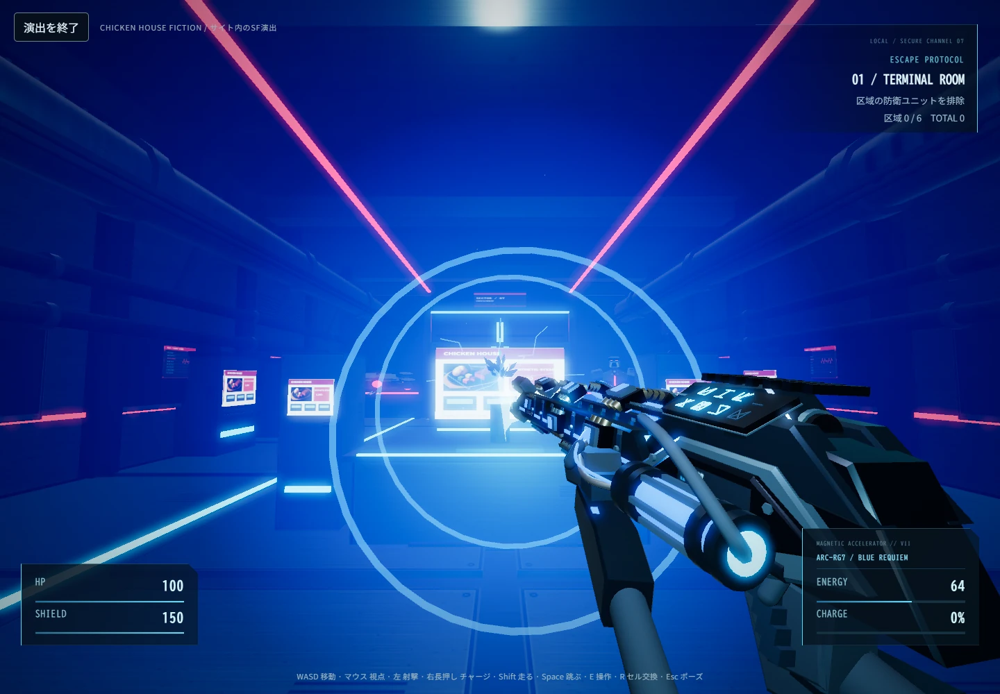

## 自動 / R セル交換

8個の独自グリフが実エネルギー残量に合わせて消灯します。空セルは自動交換、Rで先行交換。左手がセルに追従し、1.8秒後に再装填されます。

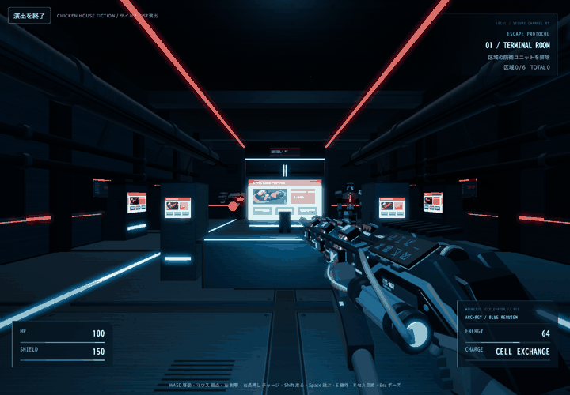

GIFは実ゲームを約0.15秒ずつ進め、撮影中のみ一時停止した12枚の連番から構成しています。連続録画ではありません。

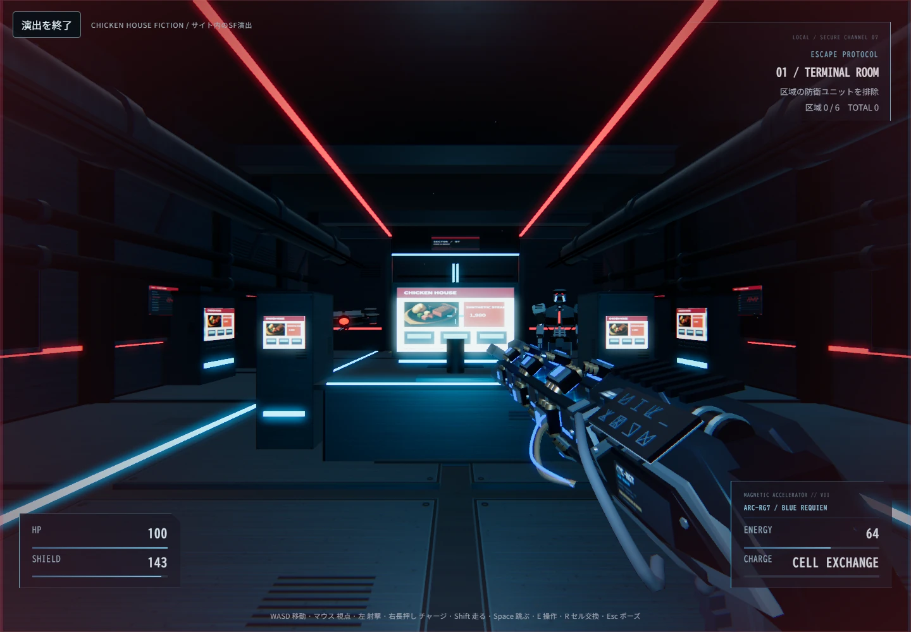

## Execution Soldier — 接近

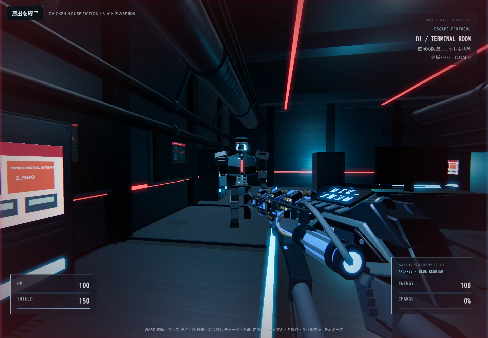

## 原子炉 / 敵12体の場面

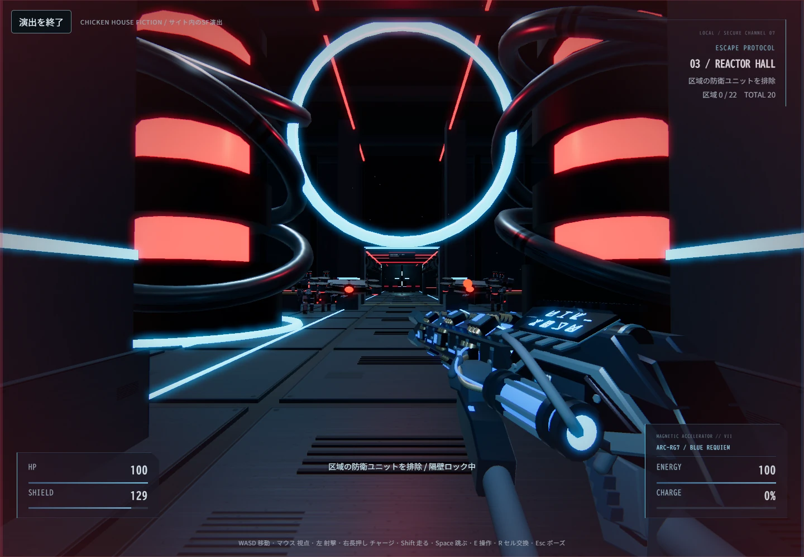

## チャージ命中 / Heavy Enforcer の破壊

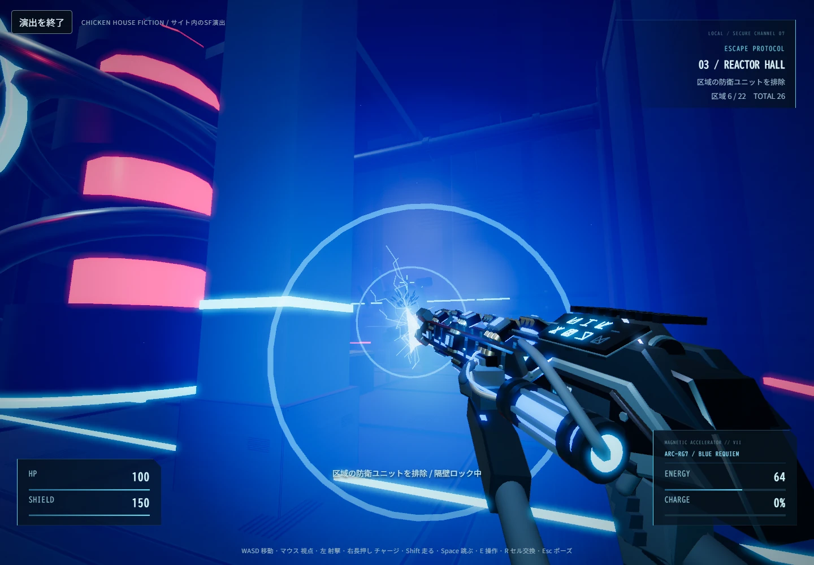

## 支配者 / 玉座

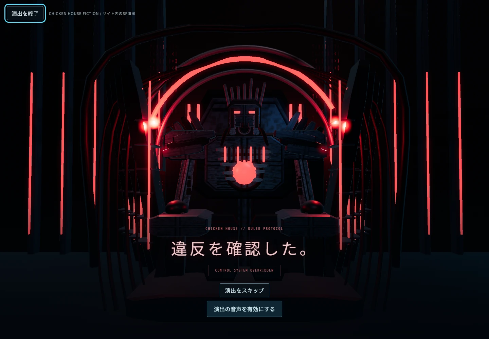

---

## 改修前の記録

以下は比較用の旧実装です。

# 実プレイ画面

実際のブラウザーから取得した画面。キャンペーンの進行には加速QAを利用している。静止画をゲーム画面として表示する実装ではない。

## 通常サイト

## 危険色ポップアップの増殖

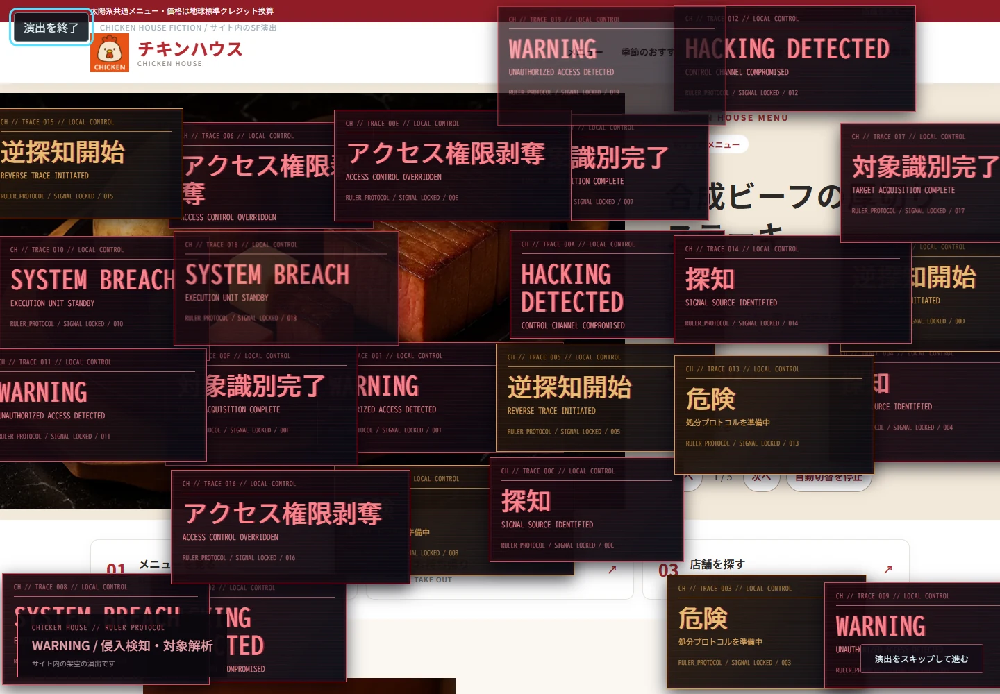

## 500msの赤コード上書き

## 支配者の処刑メッセージ

## 端末から引くカメラ

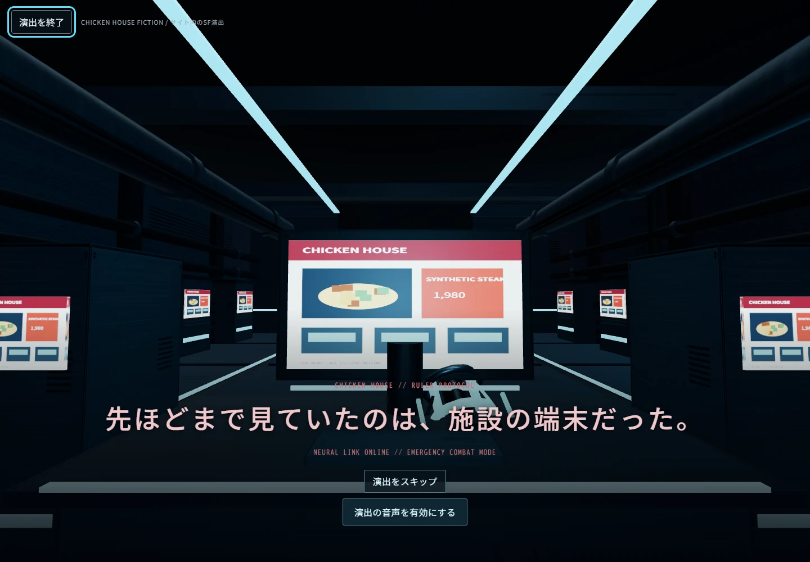

## FPSとレールガン

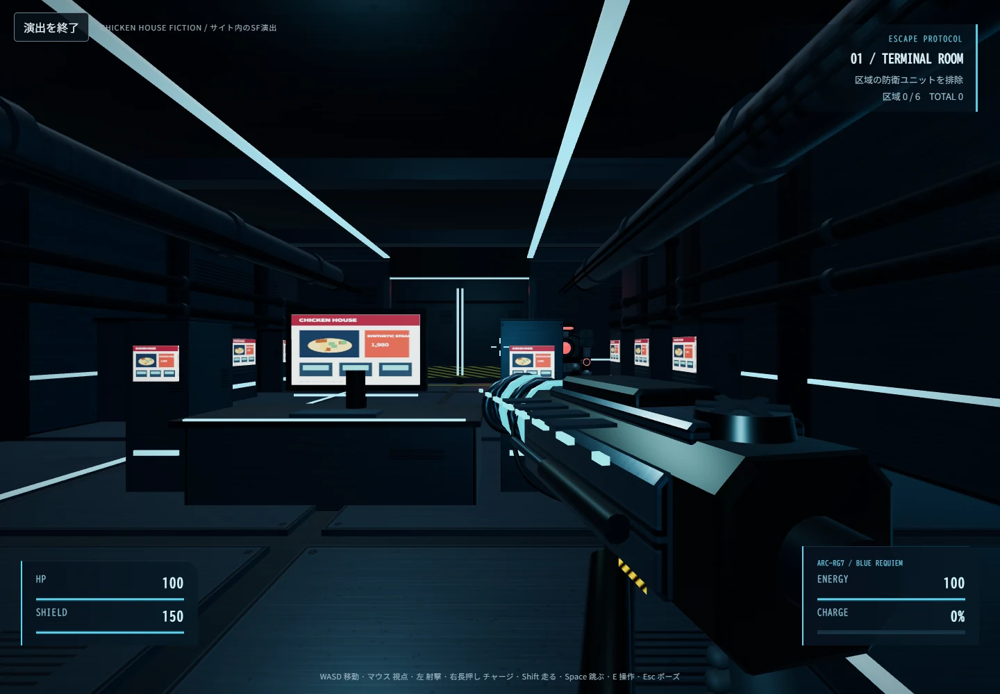

## チャージ射撃

## 原子炉ホールの戦闘

## 大型敵の破壊

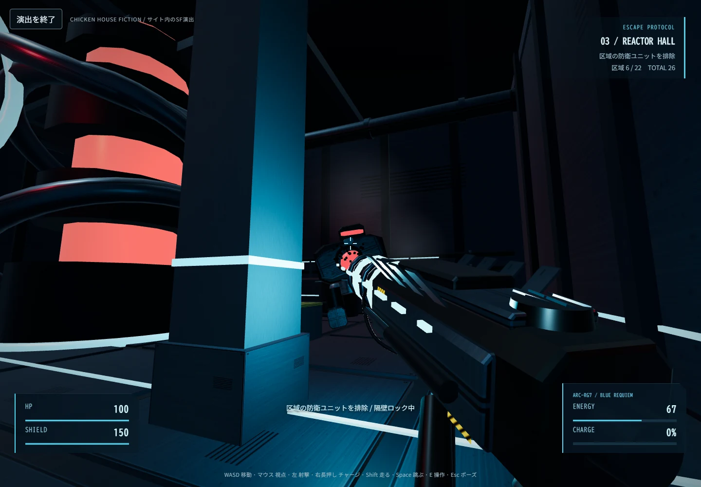

## 脱出成功

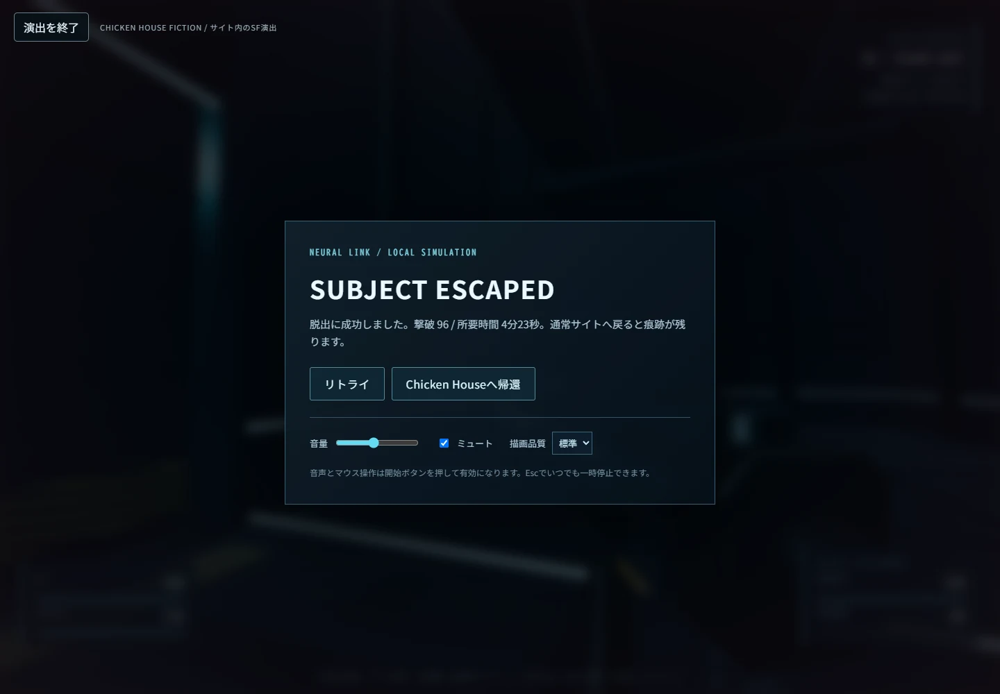
