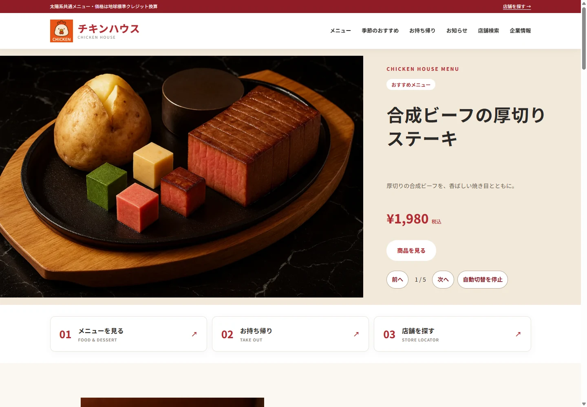
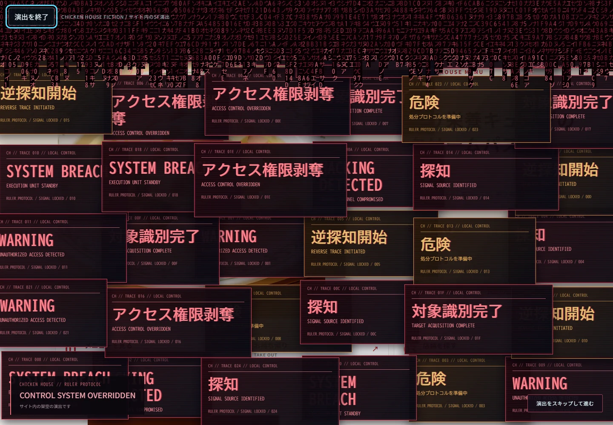
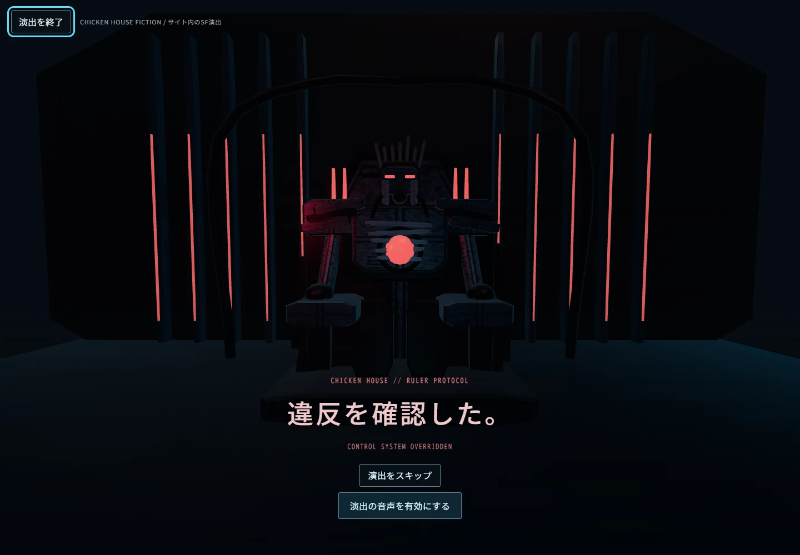
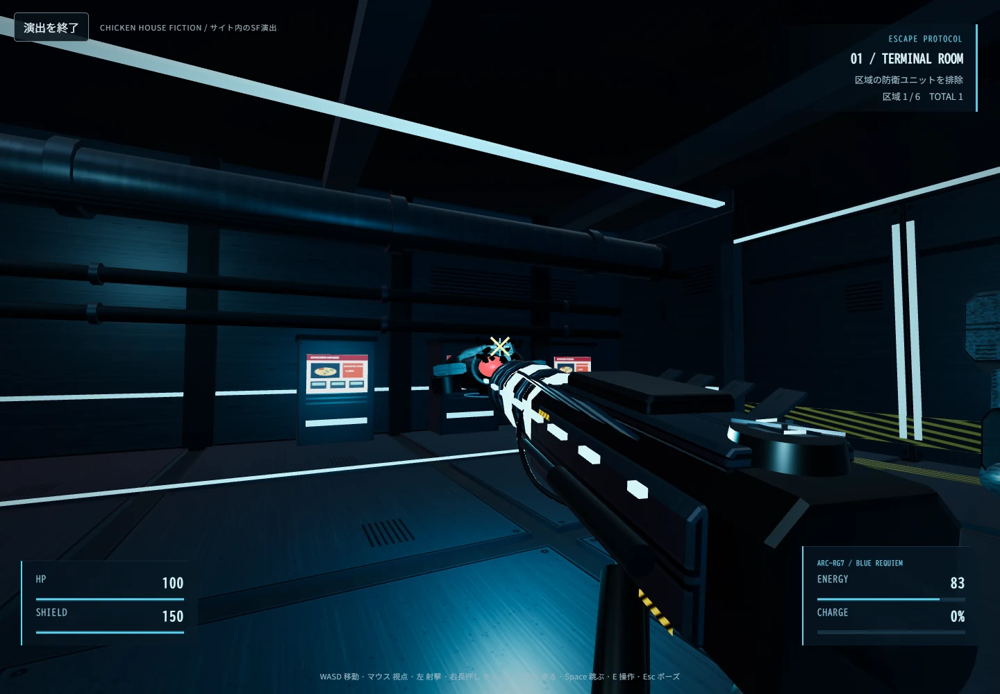
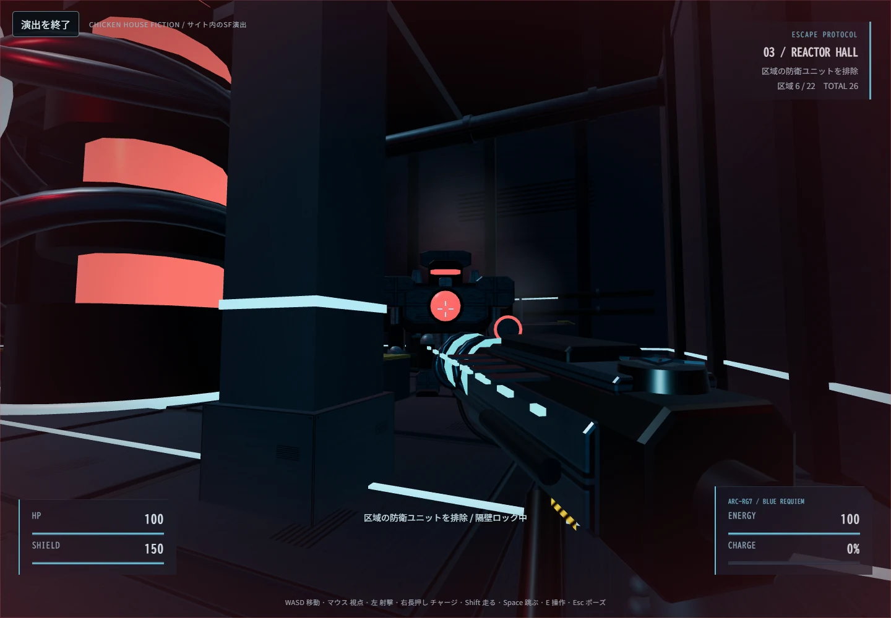

# 実プレイ画面

実際のブラウザーから取得した画面。キャンペーンの進行には加速QAを利用している。静止画をゲーム画面として表示する実装ではない。

## 通常サイト

## 危険色ポップアップの増殖

## 500msの赤コード上書き

## 支配者の処刑メッセージ

## 端末から引くカメラ

## FPSとレールガン

## チャージ射撃

## 原子炉ホールの戦闘

## 大型敵の破壊

## 脱出成功

